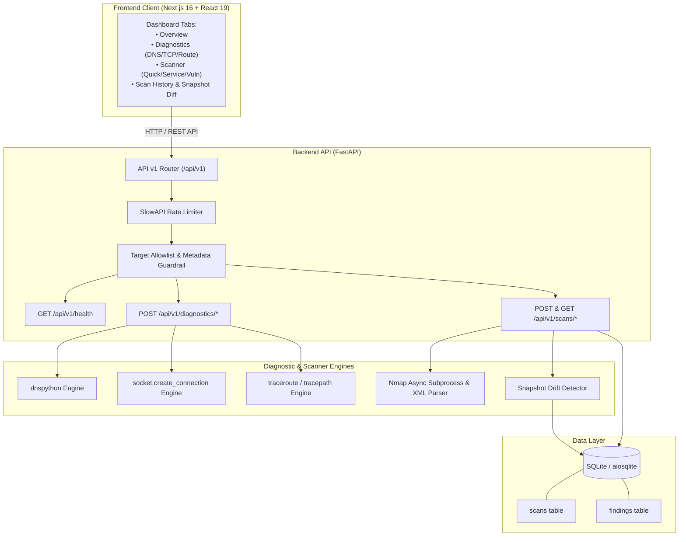

# 🛰️ NetDigno — Network Diagnostics & Security Platform

**NetDigno** is a production-minded network infrastructure diagnostics and security assessment platform. It evolves a legacy single-file script into an enterprise-ready, modular full-stack application for network engineers, systems administrators, and security teams.

[]()
[](https://fastapi.tiangolo.com)
[](https://nextjs.org)
[](https://python.org)
[](https://docker.com)
[](LICENSE)

---

## 📌 Problem Solved

Legacy vulnerability scanning scripts typically execute ad-hoc, untracked Nmap scans from arbitrary shells without security boundaries, structured storage, or comparison over time:
- **No Target Scoping**: Blindly scanning any IP or hostname without validation introduces compliance, security, and cloud abuse risks.
- **No Temporal History**: Scan output printed to terminal stdout vanishes, leaving no audit trail of which ports were opened or closed.
- **Fragile Parsing**: Regex parsing of raw Nmap console text frequently misclassifies service versions and CVEs.
- **Zero Diagnostics**: Network issues (such as DNS failure or firewall filtering) are often misdiagnosed as offline hosts.

**NetDigno solves these problems by providing:**
1. **Target Allowlist & Anti-Rebinding Guardrails**: Enforces permitted IP, CIDR, and hostname ranges with pre-scan DNS resolution validation and hard rejection of cloud metadata endpoints (`169.254.0.0/16`) and link-local ranges (`fe80::/10`).
2. **Layered Diagnostic Tools**: Independent DNS, TCP, and route diagnostic checks that distinguish between DNS resolution failures, connection timeouts, and filtered ports.
3. **Structured XML Parsing**: Extracts open ports, services, versions, CPEs, and NSE script findings using strict XML ElementTree parsing.
4. **Persistent Historical Records**: Stores all scan metadata and findings in an asynchronous SQLite database.
5. **Snapshot Comparison & Drift Detection**: Compares any two completed scans for the same host to highlight new open ports, closed ports, service version upgrades, and new CVEs.
6. **Unified Web Dashboard**: Responsive Next.js interface with real-time feedback, detailed modal inspection, and live diagnostics.

---

## 🏗️ Architecture



For complete technical specifications, review [docs/ARCHITECTURE.md](docs/ARCHITECTURE.md).

---

## 🛠️ Technology Stack

| Layer | Technology | Rationale |
|:---|:---|:---|
| **Frontend** | Next.js 16 (App Router), React 19, TypeScript | Server and client component efficiency, strict typing |
| **Styling** | Tailwind CSS 4, custom dark theme tokens | Sleek, modern operations center aesthetic |
| **Backend** | Python 3.11 / 3.12, FastAPI, Uvicorn | High-concurrency async ASGI web framework |
| **Database** | SQLite, SQLAlchemy 2.0 (Async), aiosqlite | Zero-maintenance persistent storage with migration readiness |
| **Diagnostics** | dnspython 2.7, Python socket, traceroute | Standards-compliant DNS lookups & bounded socket connections |
| **Scanning** | Nmap 7.9+, `xml.etree.ElementTree` | Industry standard network scanner with robust XML output parsing |
| **Security** | SlowAPI (rate limiting), Python `ipaddress` | Token-bucket rate limiting and strict CIDR/IP allowlists |
| **Containers** | Docker, Docker Compose | Non-root container runtime with health checks |

---

## 📋 Prerequisites

- **Node.js**: v18.0.0 or higher
- **Python**: v3.11 or v3.12
- **Nmap**: Installed locally (`brew install nmap` on macOS, `sudo apt-get install nmap` on Debian/Ubuntu)
- *(Optional)* **Docker & Docker Compose**: For containerized deployment

---

## 🚀 Quick Start (Local Installation)

### 1. Clone & Configure
```bash
git clone https://github.com/aryansinghshaktawat/vuln-scanner-webapp.git
cd vuln-scanner-webapp
```

### 2. Backend Setup
```bash
cd backend

# Create and activate virtual environment
python3 -m venv .venv
source .venv/bin/activate

# Install dependencies
pip install -r requirements.txt

# Configure environment
cp .env.example .env

# Start FastAPI backend (port 8000)
uvicorn main:app --host 127.0.0.1 --port 8000 --reload
```

Verify backend health:
```bash
curl http://127.0.0.1:8000/api/v1/health
```

### 3. Frontend Setup
```bash
cd ../frontend

# Install dependencies
npm install

# Start development server (port 3000)
npm run dev
```

Open [http://localhost:3000](http://localhost:3000) in your browser.

---

## 🐳 Docker Compose Deployment

To build and run both services in isolated containers:

```bash
docker-compose up --build -d
```

- **Frontend Dashboard**: [http://localhost:3000](http://localhost:3000)
- **Backend API**: [http://localhost:8000](http://localhost:8000)
- **Interactive OpenAPI Documentation**: [http://localhost:8000/docs](http://localhost:8000/docs)

To stop the containers:
```bash
docker-compose down
```

---

## ⚙️ Configuration (`.env`)

Configure the backend via `backend/.env` (see `backend/.env.example` for all options):

```ini
# Server
HOST=127.0.0.1
PORT=8000
LOG_LEVEL=INFO

# Security & CORS
CORS_ORIGINS=http://localhost:3000,http://127.0.0.1:3000

# Target Allowlist (Permitted targets: IP, CIDR, or Hostname)
ALLOWED_TARGETS=127.0.0.1,127.0.0.0/8,192.168.0.0/16,10.0.0.0/8,localhost,scanme.nmap.org

# Rate Limits
DIAGNOSTICS_RATE_LIMIT=30/minute
SCAN_RATE_LIMIT=5/minute

# Execution Timeouts & Bounds
MAX_CONCURRENT_SCANS=2
NMAP_QUICK_TIMEOUT=60
NMAP_SERVICE_TIMEOUT=180
NMAP_VULN_TIMEOUT=300
DNS_TIMEOUT=5.0
TCP_CONNECT_TIMEOUT=5.0

# Database
DATABASE_URL=sqlite+aiosqlite:///./data/netdigno.db
```

---

## 🧪 Testing

NetDigno includes a complete automated test suite covering unit tests and API integration tests:

```bash
cd backend
source .venv/bin/activate

# Run full pytest test suite
pytest -v
```

**Results:**
```
======================== 58 passed in 0.54s ========================
```

To run frontend build & type checks:
```bash
cd frontend
npm run build
```

For more details on tests and coverage, see [docs/TESTING.md](docs/TESTING.md).

---

## 🛡️ Security Limitations & Guardrails

- **Defensive Scope**: NetDigno is designed strictly for networks you own or are legally authorized to test.
- **TCP Connect Scans**: By default, scans use TCP connect (`-sT`), allowing execution inside unprivileged non-root containers without needing raw network socket privileges (`CAP_NET_RAW`).
- **Cloud Metadata & Link-Local Protections**: Target allowlist blocks cloud metadata (`169.254.0.0/16`) and link-local ranges, validating resolved IPs to prevent DNS rebinding attacks.
- **Firewalls & Filters**: Packet drops, firewall filtering, and rate limits on target routers can cause ports to appear closed or filtered. A failed connection does not confirm a host outage.
- **Allowlist Enforced**: Targets outside `ALLOWED_TARGETS` are rejected with HTTP 403 Forbidden without executing subprocesses.

For complete security disclosure, review [docs/SECURITY.md](docs/SECURITY.md).

---

## 📖 Documentation Index

- 📘 [docs/ARCHITECTURE.md](docs/ARCHITECTURE.md) — System architecture, design decisions, and data models
- 📗 [docs/API.md](docs/API.md) — Complete REST API v1 endpoint specifications and payload schemas
- 📕 [docs/SECURITY.md](docs/SECURITY.md) — Security guardrails, allowlists, and subprocess hardening
- 📙 [docs/TESTING.md](docs/TESTING.md) — Automated testing guide, fixtures, and verification
- 📓 [docs/IMPLEMENTATION_PLAN.md](docs/IMPLEMENTATION_PLAN.md) — Transformation audit and implementation record

---

## 📄 License

This project is licensed under the MIT License — see the [LICENSE](LICENSE) file for details.
