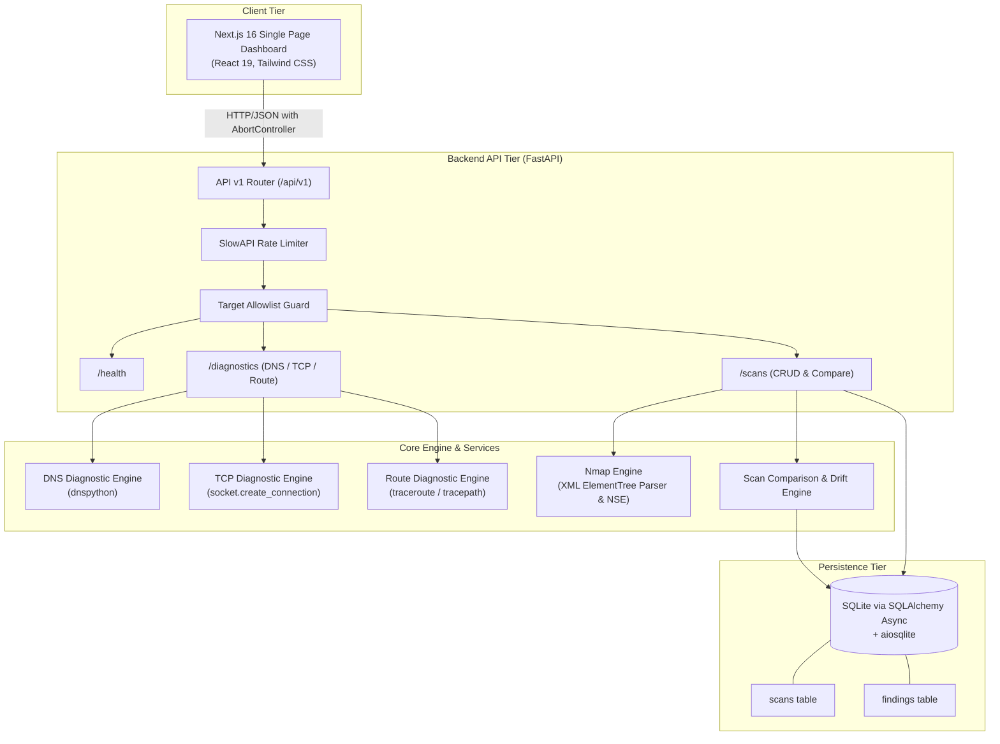
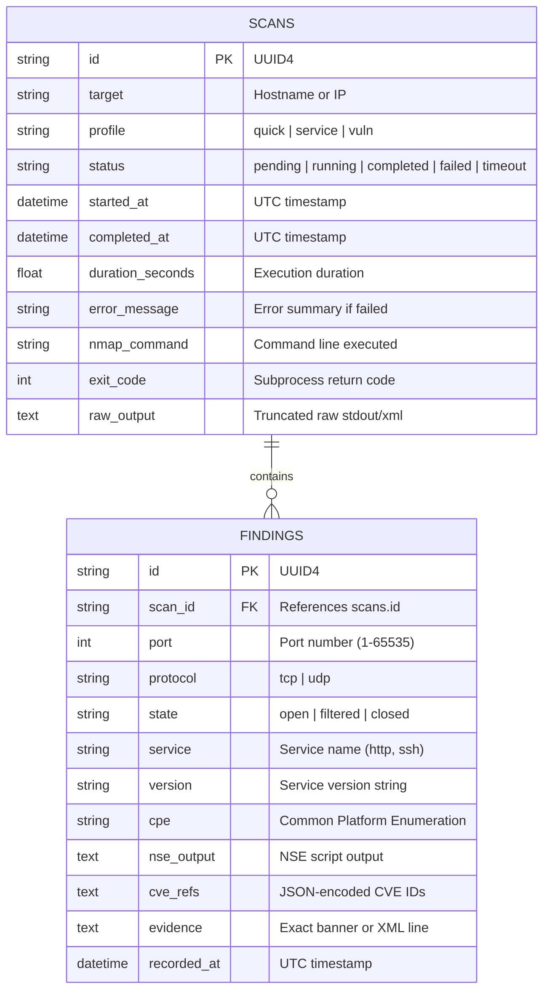

# NetScope Architecture

## 1. System Overview

**NetScope** is a modern network infrastructure diagnostics and security assessment platform. It evolves a legacy single-file script into an enterprise-ready, modular full-stack application capable of:

- Safe DNS resolution diagnostics (A and AAAA records, timing, error classification)
- Bounded TCP port connectivity verification with precise timing
- Route path diagnostics (traceroute / tracepath with hop count and RTT tracking)
- Guardrailed, profile-based Nmap scanning with structured XML parsing
- Persistent SQLite storage for historical scans and discovered findings
- Baseline snapshot comparison for infrastructure drift and port change detection
- Defensive security controls (target allowlists, strict rate limiting, non-root containers)



---

## 2. Component Architecture

### 2.1 Backend Architecture (`backend/app`)

The backend is structured into modular layers adhering to separation of concerns:

```
backend/
├── app/
│   ├── api/v1/             # HTTP Route Handlers
│   │   ├── health.py       # Health check & scanner readiness
│   │   ├── diagnostics.py  # DNS, TCP, and Route diagnostic endpoints
│   │   ├── scans.py        # Scan lifecycle, list, detail, and comparison
│   │   └── router.py       # Aggregated v1 API router
│   ├── core/               # Configuration and application telemetry
│   │   ├── config.py       # Pydantic Settings (.env, defaults)
│   │   └── logging.py      # Structured ISO-8601 logging
│   ├── models/             # SQLAlchemy ORM Models
│   │   ├── base.py         # Async engine, sessionmaker, table init
│   │   ├── scan.py         # Scan record (target, profile, status, exit code)
│   │   └── finding.py      # Individual discovered port/service/CVE
│   ├── repositories/       # Data Access Layer
│   │   └── scan_repository.py # Async CRUD queries with eager loading
│   ├── schemas/            # Pydantic Request/Response DTOs
│   │   ├── diagnostics.py  # DnsRequest/Result, TcpRequest/Result, RouteRequest/Result
│   │   └── scans.py        # ScanRequest/Out, ComparisonResult, PaginatedScans
│   ├── security/           # Access Control and Guardrails
│   │   └── allowlist.py    # Target validation with IP/CIDR/Hostname matching
│   └── services/           # Business Logic & Process Execution
│       ├── dns_diagnostics.py  # DNS resolution via dnspython
│       ├── tcp_diagnostics.py  # Bounded socket connection tests
│       ├── route_diagnostics.py# Subprocess traceroute parser
│       ├── nmap_service.py     # Nmap runner and XML parser
│       └── scan_comparison.py  # Snapshot diff engine
├── tests/                  # Automated pytest test suite
│   ├── unit/               # Unit tests (allowlist, parser, diff, repo, diag)
│   └── integration/        # Full FastAPI HTTP endpoint tests
├── Dockerfile              # Hardened container with non-root netscope user
└── requirements.txt        # Pinned dependencies
```

### 2.2 Security Boundary & Guardrails

1. **Target Allowlist Enforcement**:
   - `ALLOWED_TARGETS` configuration accepts explicit hostnames (`localhost`, `scanme.nmap.org`) and CIDR ranges (`127.0.0.0/8`, `192.168.0.0/16`, `10.0.0.0/8`).
   - Hostnames are resolved to IP addresses before scanning; both the resolved IP and hostname must match permitted CIDR/hostname entries.
   - Prevents scanning unintended public ranges or cloud metadata endpoints (`169.254.169.254`).
2. **Explicit User Authorisation**:
   - Every scan request requires `authorized: true` confirmed by the operator.
3. **Subprocess Sandboxing**:
   - Subprocesses never use `shell=True`. Arguments are passed as an explicit array.
   - Strict execution timeouts prevent runaway processes.
   - Concurrency semaphore (`MAX_CONCURRENT_SCANS`) limits simultaneous scans to protect system resources.
4. **Rate Limiting**:
   - Built with SlowAPI (Token bucket algorithm).
   - Configurable per-minute limits for diagnostic tests and active scans.

---

## 3. Data Persistence Model

NetScope uses an asynchronous SQLite database using SQLAlchemy 2.0 and `aiosqlite`.



---

## 4. Diagnostics Subsystem

1. **DNS Diagnostics**:
   - Uses `dnspython` to query both `A` and `AAAA` records.
   - Classifies query responses into structured error codes: `NXDOMAIN`, `NO_ANSWER`, `NO_NAMESERVERS`, `TIMEOUT`, `UNKNOWN`.
   - Explicit disclaimer: Resolution success confirms domain mapping only, not service reachability.
2. **TCP Diagnostics**:
   - Uses non-blocking socket connection (`socket.create_connection`) bounded by a configurable timeout.
   - Distinguishes connection refusal (`ECONNREFUSED`), timeout, and network unreachable errors.
3. **Route Diagnostics**:
   - Attempts `traceroute` or `tracepath` depending on platform availability.
   - Safely parses hop count, hop IP addresses, and round-trip times. Returns clear failure diagnostics if traceroute binaries are missing or restricted.

---

## 5. Nmap Scanner & Snapshot Comparison

1. **Scanning Profiles**:
   - `quick`: Fast TCP connect scan on common ports (`-sT -T4 --top-ports 100`).
   - `service`: Service version detection (`-sV -sT -T4 --top-ports 250`).
   - `vuln`: Service detection plus vulnerability scanning scripts (`-sV -sT --script vuln`).
2. **XML Parsing**:
   - Rather than relying on fragile regex on terminal output, NetScope executes with `-oX -` to produce structured XML.
   - `xml.etree.ElementTree` extracts port states, service names, product versions, CPE identifiers, and NSE script tables.
   - CVE identifiers are extracted from script IDs and CVE references with strict format matching (`CVE-\d{4}-\d{4,7}`).
3. **Snapshot Comparison & Drift Detection**:
   - Compares any two completed scans for the same target.
   - Identifies:
     - **New open ports**: Ports detected in current scan not present in baseline.
     - **Closed / disappeared ports**: Ports open in baseline now closed.
     - **Service / version changes**: Ports where service version has upgraded or changed.
     - **New vulnerabilities**: New CVEs found in current scan that were not in baseline.
